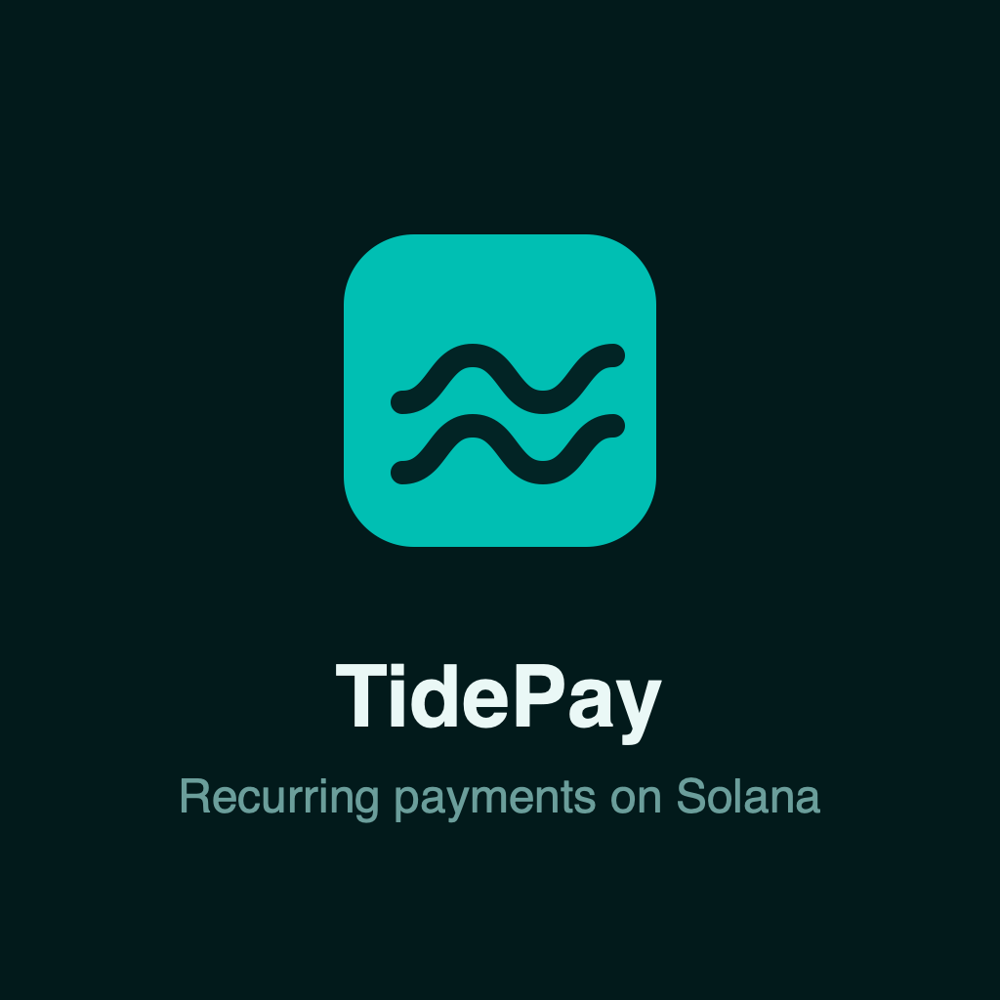
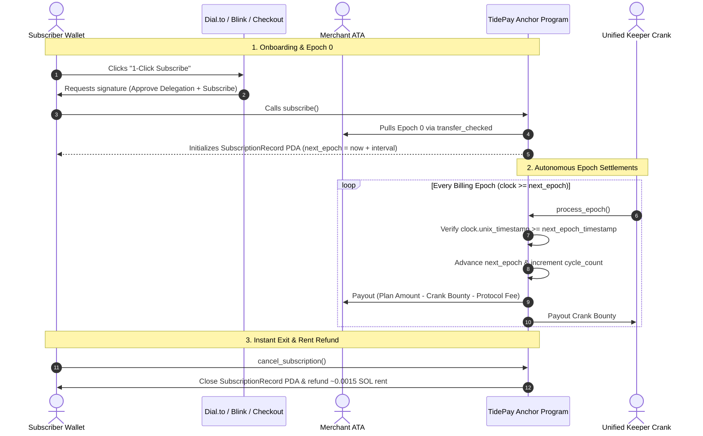
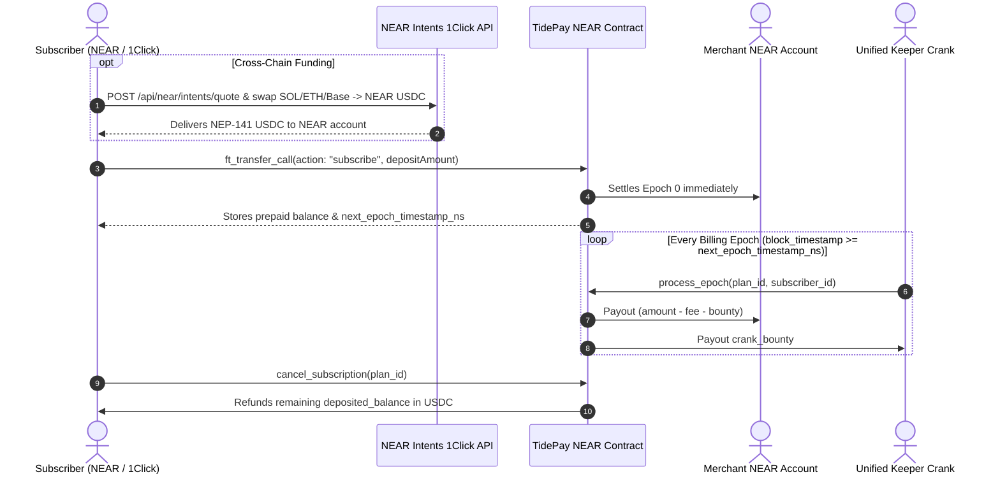

<div align="center">



# TidePay

**The Non-Custodial Multi-Chain Recurring Subscription & Billing Engine for Solana & NEAR**

[](https://explorer.solana.com/address/DfAycPzXuSu4EzqfAprZ11S8oQZ6nucuRniFNrNaK5CQ?cluster=devnet)
[](https://testnet.nearblocks.io/address/tidepay-mw1rpoyp.tidepay-e2e-mw1rpm6j.testnet)
[](https://www.anchor-lang.com/)
[](https://nextjs.org/)
[](https://www.typescriptlang.org/)
[](https://opensource.org/licenses/MIT)

[🌐 Live Landing](https://tidepay.vercel.app) • [📊 Merchant Console](https://app-tidepay.vercel.app) • [⚡ Actions & Intents API](https://api-tidepay.vercel.app) • [🚀 Deployment Guide](./DEPLOY.md) • [📑 Architecture & PRD](./docs/ARCHITECTURE_AND_PRD.md)

</div>

---

## NEAR Hackathon 2026 Submission

**Track:** Real-World Money (`realworld`)  
**What it is:** A non-custodial recurring billing contract for NEAR. A merchant creates a plan (price, interval, keeper bounty). A subscriber pays epoch 0 and prepays later cycles in a NEP-141 token. After each interval anyone can call `process_epoch`; the contract splits the payment between merchant, protocol fee and the keeper that called it. Settlement is time-locked on-chain (`block_timestamp >= next_epoch_timestamp_ns`). Subscribers can cancel and get the unused balance back.  
**NEAR's role:** Prepaid NEP-141 balances held by the contract and settled by a permissionless keeper, plus NEAR Intents (1Click) so a subscriber on Solana, Ethereum or Base can fund their NEAR account.

**Prior work (Q-002, Q-005):** TidePay existed before the hackathon as a Solana/Anchor product (programs, dashboard, Actions API, Solana crank, landing and docs). That baseline is the commit `eb26be3` (2026-10-12), tagged `pre-hackathon`. Everything NEAR-specific was written on branch `feat/near` from 2026-11-03: [`packages/contracts-near`](./packages/contracts-near) (contract), [`packages/sdk-near`](./packages/sdk-near) (TypeScript client), [`packages/protocol-near/crank`](./packages/protocol-near/crank) (keeper, deploy and e2e scripts), the 1Click and gas-sponsor routes in [`apps/api/src/app/api/near`](./apps/api/src/app/api/near), and the NEAR support in [`apps/dashboard`](./apps/dashboard) (embedded NEAR account, NEAR plans, NEAR checkout). [Diff against baseline](https://github.com/TeddyHuZz/tidepay/compare/pre-hackathon...feat/near).

### Try it (do X, see Y)

Requirements: Rust with `wasm32-unknown-unknown`, Node 20+, pnpm, `pnpm install`.

1. **Contract unit tests.** `cargo test --manifest-path packages/contracts-near/Cargo.toml` → `13 passed`.
2. **TypeScript tests.** `pnpm --filter @tidepay/sdk-near test && pnpm --filter @tidepay/crank-near test && pnpm --filter api exec vitest run && pnpm --filter dashboard exec vitest run` → all pass.
3. **Full flow on NEAR testnet.** Get a funded testnet account (https://near-faucet.io), then:
   ```bash
   NEAR_ACCOUNT_ID=you.testnet NEAR_PRIVATE_KEY=ed25519:... ./scripts/test-near-flow.sh
   ```
   It builds the wasm, creates sub-accounts, deploys the contract, subscribes, waits one 60 s interval, runs the keeper, and checks every token balance. It prints `SUCCESS` and exits 0, or prints the first mismatch and exits 1. Takes about 3 minutes and needs about 5 testnet NEAR. It uses the existing `usdc.fakes.testnet` token (6 decimals, open `mint`).
4. **Cross-chain funding quote (dry run, mainnet data, no funds move).**
   ```bash
   curl -X POST localhost:3001/api/near/intents/quote -H 'content-type: application/json' -d '{"originAsset":"nep141:sol-5ce3bf3a31af18be40ba30f721101b4341690186.omft.near","amount":"10000000","refundTo":"<solana address>","recipient":"alice.near","dry":true}'
   ```
   → a quote converting 10 USDC on Solana to about 9.99 USDC on NEAR. NEAR Intents has no testnet (Q-007), so only dry quotes were run.

**Recorded testnet run (2026-11-04):** contract [`tidepay-mw1pwi6c.tidepay-e2e-mw1pwb5j.testnet`](https://testnet.nearblocks.io/address/tidepay-mw1pwi6c.tidepay-e2e-mw1pwb5j.testnet); keeper settlement tx [`9uSdehPKCX6qFB3YzDzU2fkvVRTQuRrDaQjZrswy813M`](https://testnet.nearblocks.io/txns/9uSdehPKCX6qFB3YzDzU2fkvVRTQuRrDaQjZrswy813M). The dashboard uses a separate deployment with the index views: [`tidepay-mw1rpoyp.tidepay-e2e-mw1rpm6j.testnet`](https://testnet.nearblocks.io/address/tidepay-mw1rpoyp.tidepay-e2e-mw1rpm6j.testnet).

### Merchant flow in the dashboard (one login, two chains)

A merchant signs in once (email, Google, or a Solana wallet) and can create and manage plans on Solana Devnet or NEAR Testnet from `apps/dashboard` without installing a NEAR wallet.

- **How the NEAR account works.** The merchant's NEAR key is derived in the browser from one signature by their Solana wallet (message `TidePay NEAR account v1\n<solana address>`, key = SHA-256 of the signature). It is kept in memory only and never sent anywhere. The same login gives the same NEAR account on any device, so the NEAR account is exactly as recoverable as the Solana wallet: **losing access to the login means losing the NEAR account, its plans and its payouts.** The two accounts have different addresses (the NEAR one is a 64-character hex implicit account).
- **First use.** The first NEAR action asks the wallet for the signature, then the app funds the account with 0.5 testnet NEAR through a gas-sponsor route (`POST /api/near/sponsor`, testnet only, rate limited) and registers it on the token. Later page loads show NEAR plans without any prompt.
- **Create a plan.** `/plans/new` → choose **NEAR Testnet** → the checkout link is `/checkout/near/<plan id>`. NEAR plans have no Blink.
- **Subscribers** use their own wallet: a NEAR wallet (NEAR Connect) on the NEAR checkout page, a Solana wallet on the Solana one. On testnet the NEAR checkout has a **Get test USDC** button.
- **Setup.** Set `NEXT_PUBLIC_TIDEPAY_NEAR_CONTRACT` in `apps/dashboard/.env.local` (deploy your own with `./scripts/deploy-near-contract.sh`), and `NEAR_SPONSOR_ACCOUNT_ID` / `NEAR_SPONSOR_PRIVATE_KEY` in `apps/api/.env.local`. Email and Google sign-in must also be enabled in the Privy dashboard for the app id in use.
- **Plan IDs are global on NEAR.** Two merchants cannot use the same plan ID; the second gets "A plan with this ID already exists on NEAR".
- **Keeper discovery:** `@tidepay/crank-near` automatically discovers active subscriptions via NEAR RPC `view_state` (`b"s"` prefix), skips depleted prepaid balances, registers keeper token storage once when `crank_bounty > 0`, and runs inside the unified `@tidepay/crank` worker alongside Solana (`NEAR_CRANK_WATCH` remains supported as an optional override).

### Known limits
- A failed token payout (for example a receiver not registered on the token) does not roll back the subscription state. A `ft_resolve_transfer` callback is not implemented.
- The dashboard's NEAR browser flows (embedded-account setup, plan form, NEAR Connect checkout) were verified by replaying their exact chain calls against testnet and by unit tests, not by a person clicking through them in a browser.
- The 1Click routes deliver USDC to the subscriber's NEAR account. The subscriber then calls `subscribe`; it is not one atomic step. Executing a real swap was not tested.
- Not audited. Testnet only.

---

## ⚡ The Problem & The TidePay Paradigm

Traditional Web3 subscription implementations force users to lock upfront capital in opaque custodial escrow vaults or manually sign monthly approval popups.

* **Custodial Escrows:** Freeze user liquidity with no clean deterministic exit, forfeit yield, and create smart contract honeypots.
* **Monthly Signatures:** Asking users for recurring manual wallet popups causes steep drop-off and churn.

### The TidePay Solution: Multi-Chain Non-Custodial Subscriptions

TidePay unifies recurring billing across **Solana** and **NEAR** using native on-chain time-locks (`clock.unix_timestamp >= next_epoch_timestamp` on Solana; `block_timestamp >= next_epoch_timestamp_ns` on NEAR) and a shared permissionless keeper crank:

1. **Solana — Delegated Pull Billing:** Subscribers authorize an SPL / Token-2022 delegation (`approve`) to the Program Authority PDA (`b"tidepay_auth"`). Funds remain in the subscriber's personal wallet until each billing epoch is due, then `transfer_checked` pulls the exact cycle amount.
2. **NEAR — Prepaid NEP-141 & 1Click Intents:** Subscribers deposit epoch 0 plus prepaid cycles in a NEP-141 token (`ft_transfer_call`) or fund their NEAR account cross-chain via NEAR Intents 1Click. Unused prepaid balances remain immediately refundable on cancellation.
3. **Checks-Effects-Interactions:** On both chains, state mutations (`cycle_count`, `next_epoch_timestamp` / `deposited_balance`) occur **before** external token transfer calls.
4. **Checkout Distribution:** Share Solana plans as interactive **Solana Actions / Blinks** on X and [dial.to](https://dial.to), or send subscribers directly to hosted `/checkout/[planId]` and `/checkout/near/[planId]` pages.
5. **Unified Keeper Crank Network:** `@tidepay/crank` settles both Solana due PDAs and NEAR active subscriptions (auto-discovered via `@tidepay/crank-near` RPC `view_state`) for a protocol-defined keeper bounty.
6. **Clean On-Chain Exit:** Cancelling on Solana closes `SubscriptionRecord` and refunds ~0.0015 SOL rent lamports (`close = subscriber`). Cancelling on NEAR marks the subscription inactive and transfers remaining `deposited_balance` back to the subscriber.

---

## 📊 Paradigm Comparison

| Feature | Traditional Web2 (Stripe) | Custodial Web3 Escrow | TidePay (Solana) | TidePay (NEAR) |
| :--- | :--- | :--- | :--- | :--- |
| **Billing Model** | Card Pull (Custodial) | Locked Escrow Vault | **Delegated SPL Pull (`approve`)** | **Prepaid NEP-141 Allowance** |
| **Distribution** | Hosted Link | dApp Modal | **Solana Blinks & Hosted Checkout** | **Hosted Checkout & 1Click Intents** |
| **Settlement** | Off-chain Batch | Admin Cron | **Permissionless Keeper (`0.05 USDC` bounty)** | **Permissionless Keeper (`crank_bounty`)** |
| **Yield / Capital** | Merchant/Bank | Trapped in Protocol | **Stays in Subscriber Wallet** | **Stays Refundable Anytime** |
| **Cancellation** | Support / Portal | Complex / Timelocked | **Closes PDA + Refunds SOL Rent** | **Instant Unused USDC Refund** |

---

## 🛰️ Live On-Chain Deployments

### Solana Devnet
| Component | Identifier / Address | Details |
| :--- | :--- | :--- |
| **Program ID** | [`DfAycPzXuSu4EzqfAprZ11S8oQZ6nucuRniFNrNaK5CQ`](https://explorer.solana.com/address/DfAycPzXuSu4EzqfAprZ11S8oQZ6nucuRniFNrNaK5CQ?cluster=devnet) | Anchor 0.30+ program on Solana Devnet |
| **Program Authority PDA** | Derived from `[b"tidepay_auth"]` | Non-custodial pull delegate for CPI `transfer_checked` |
| **Devnet USDC Mint** | [`4zMMC9srt5Ri5X14GAgXhaHii3GnPAEERYPJgZJDncDU`](https://explorer.solana.com/address/4zMMC9srt5Ri5X14GAgXhaHii3GnPAEERYPJgZJDncDU?cluster=devnet) | Circle Devnet USDC (6 decimals) |
| **Actions & Intents API** | `https://api-tidepay.vercel.app` | Solana Actions/Blinks + NEAR Sponsor & 1Click proxy |

### NEAR Testnet
| Component | Identifier / Address | Details |
| :--- | :--- | :--- |
| **Dashboard Contract** | [`tidepay-mw1rpoyp.tidepay-e2e-mw1rpm6j.testnet`](https://testnet.nearblocks.io/address/tidepay-mw1rpoyp.tidepay-e2e-mw1rpm6j.testnet) | Deployed WASM contract used by `apps/dashboard` |
| **E2E Recorded Contract** | [`tidepay-mw1pwi6c.tidepay-e2e-mw1pwb5j.testnet`](https://testnet.nearblocks.io/address/tidepay-mw1pwi6c.tidepay-e2e-mw1pwb5j.testnet) | Verified end-to-end keeper settlement ([tx](https://testnet.nearblocks.io/txns/9uSdehPKCX6qFB3YzDzU2fkvVRTQuRrDaQjZrswy813M)) |
| **Testnet USDC (NEP-141)** | `usdc.fakes.testnet` | 6-decimal faucet token with **Get test USDC** in checkout |
| **Testnet RPC** | `https://test.rpc.fastnear.com` | FastNEAR Testnet JSON-RPC endpoint |

---

## 🏗️ Architecture & Settlement Lifecycle

### Solana: Non-Custodial Delegated Pull


### NEAR: Prepaid NEP-141 + 1Click Cross-Chain Funding


---

## 🧪 End-to-End Quickstart (60-Second Cycles)

Test the complete recurring billing lifecycle on either chain in under two minutes using the **60s Demo** interval:

1. **Open the Console:** Visit [app-tidepay.vercel.app](https://app-tidepay.vercel.app) and sign in with Privy (email, Google, or Solana wallet). On your first NEAR plan, the dashboard derives an embedded NEAR account and auto-funds testnet gas via `/api/near/sponsor`.
2. **Create a 60s Plan:** Go to `/plans/new`, pick **Solana Devnet** or **NEAR Testnet**, and choose the **60s Demo** interval.
3. **Subscribe:**
   - **Solana:** Open **Share Blink** on [dial.to](https://dial.to) or `/checkout/[planId]` and approve the delegated pull.
   - **NEAR:** Open `/checkout/near/[planId]`, click **Get test USDC** if needed, connect a NEAR wallet, and prepay 1+ cycles (or fund via NEAR Intents 1Click).
4. **Watch Autonomous Renewal:** After 60 seconds, `@tidepay/crank` settles the due epoch on-chain and triggers configured HMAC-SHA256 webhooks.
5. **Cancel & Verify Refund:** Cancel on `/checkout/[planId]` to reclaim Solana PDA rent (~0.0015 SOL), or on `/checkout/near/[planId]` to immediately reclaim unused prepaid USDC.

---

## 📦 Monorepo Structure

```
tidepay/
├── apps/
│   ├── dashboard/          # Next.js 16 App Router console, docs, & Solana/NEAR checkouts
│   ├── api/                # Next.js 16 Solana Actions/Blinks, NEAR sponsor/Intents, & webhooks API
│   └── web/                # Marketing landing page & brand assets
├── packages/
│   ├── protocol/           # Solana Anchor 0.30+ Rust program + unified keeper crank (@tidepay/crank)
│   ├── contracts-near/     # NEAR Rust NEP-141 subscription contract + unit tests
│   ├── protocol-near/crank # NEAR keeper discovery & e2e runner (@tidepay/crank-near)
│   ├── types/              # Shared Anchor IDL, TypeScript interfaces, & PDA constants
│   ├── sdk/                # Solana TypeScript client library (@tidepay/sdk)
│   └── sdk-near/           # NEAR TypeScript client library (@tidepay/sdk-near)
├── scripts/
│   ├── deploy-near-contract.sh  # Build & deploy NEAR WASM contract
│   └── test-near-flow.sh        # Live NEAR Testnet end-to-end verification script
├── docs/
│   └── ARCHITECTURE_AND_PRD.md  # Detailed technical architecture & PRD
└── DEPLOY.md                    # Vercel (web/api/dashboard) & Render (unified crank) deployment guide
```

> **Decoupled Architecture:** Applications in `apps/*` interact strictly through `@tidepay/sdk`, `@tidepay/sdk-near`, and `@tidepay/types`—never importing directly from `packages/protocol` or `packages/contracts-near`.

---

## 💻 Developer SDK Quickstart

### Solana (`@tidepay/sdk`)
```bash
pnpm add @tidepay/sdk @solana/web3.js @coral-xyz/anchor @solana/spl-token
```

```typescript
import { Connection, PublicKey } from "@solana/web3.js";
import { TidePayClient } from "@tidepay/sdk";

const connection = new Connection("https://api.devnet.solana.com", "confirmed");
const client = new TidePayClient(connection);

export async function isSolanaSubscribed(planPda: PublicKey, userWallet: PublicKey): Promise<boolean> {
  const [subscriptionPda] = client.findSubscriptionRecordPda(planPda, userWallet);
  const record = await client.getSubscriptionRecord(subscriptionPda);

  const now = BigInt(Math.floor(Date.now() / 1000));
  return Boolean(record?.isActive && now <= record.nextEpochTimestamp + 120n);
}
```

### NEAR (`@tidepay/sdk-near`)
```bash
pnpm add @tidepay/sdk-near near-api-js
```

```typescript
import { Account } from "near-api-js";
import { TidePayNearClient } from "@tidepay/sdk-near";

export async function isNearSubscribed(
  account: Account,
  contractId: string,
  planId: string,
  subscriberId: string,
): Promise<boolean> {
  const nearClient = new TidePayNearClient(account, contractId);
  const record = await nearClient.getSubscription(planId, subscriberId);

  const nowNs = BigInt(Date.now()) * 1_000_000n;
  const graceNs = 120n * 1_000_000_000n;
  return Boolean(
    record?.is_active && nowNs <= BigInt(record.next_epoch_timestamp_ns) + graceNs,
  );
}
```

---

## 🚀 Running Locally & Deploying

```bash
# 1. Install workspace dependencies
pnpm install

# 2. Start all apps & cranks via Turborepo
pnpm dev

# Dashboard: http://localhost:3000
# Actions & Intents API: http://localhost:3001
# Landing Page: http://localhost:3002
```

For production deployment of `apps/web`, `apps/api`, and `apps/dashboard` on Vercel plus the unified Solana + NEAR keeper crank on Render, see [DEPLOY.md](./DEPLOY.md).

### Running Test Suites

```bash
# NEAR Rust contract unit tests
cargo test --manifest-path packages/contracts-near/Cargo.toml

# Solana Rust protocol tests
cargo test --manifest-path packages/protocol/Cargo.toml

# TypeScript SDK, crank, API, and Dashboard test suites
pnpm --filter @tidepay/sdk-near test
pnpm --filter @tidepay/crank-near test
pnpm --filter api exec vitest run
pnpm --filter dashboard exec vitest run
```

---

## 📄 License

This repository is licensed under the [MIT License](LICENSE).
