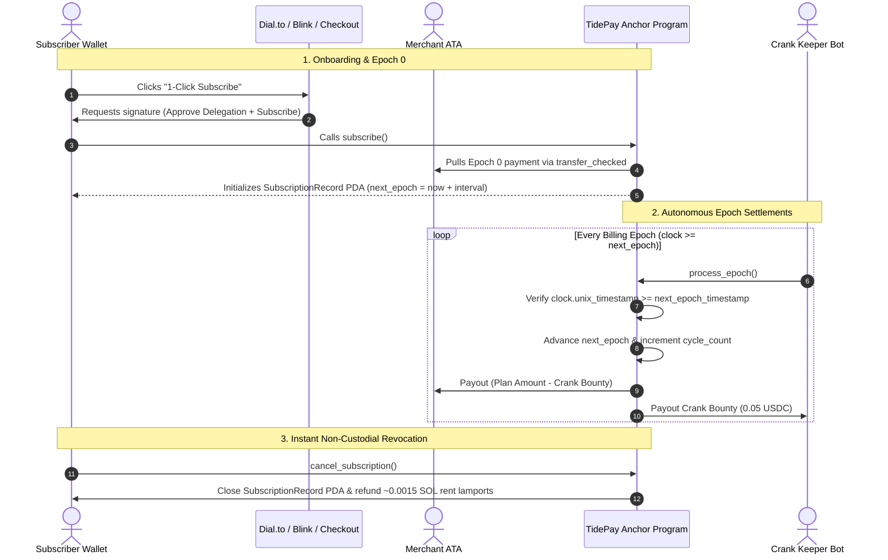

<div align="center">


# TidePay

**The Non-Custodial Recurring Subscription & Billing Engine for Solana**  
*Built natively for the Colosseum Solana Hackathon 2026*

[](https://explorer.solana.com/address/DfAycPzXuSu4EzqfAprZ11S8oQZ6nucuRniFNrNaK5CQ?cluster=devnet)
[](https://www.anchor-lang.com/)
[](https://nextjs.org/)
[](https://www.typescriptlang.org/)
[](https://vitest.dev/)
[](https://opensource.org/licenses/MIT)

[🌐 Live Landing](https://tidepay.vercel.app) • [📊 Merchant Console](https://app-tidepay.vercel.app) • [⚡ Actions API](https://api-tidepay.vercel.app) • [📑 Architecture & PRD](./docs/ARCHITECTURE_AND_PRD.md)

</div>

---

## NEAR Hackathon 2026 Submission

**Track:** Real-World Money (`realworld`)  
**What it is:** A non-custodial recurring billing contract for NEAR. A merchant creates a plan (price, interval, keeper bounty). A subscriber pays epoch 0 and prepays later cycles in a NEP-141 token. After each interval anyone can call `process_epoch`; the contract splits the payment between merchant, protocol fee and the keeper that called it. Settlement is time-locked on-chain (`block_timestamp >= next_epoch_timestamp_ns`). Subscribers can cancel and get the unused balance back.  
**NEAR's role:** Prepaid NEP-141 balances held by the contract and settled by a permissionless keeper, plus NEAR Intents (1Click) so a subscriber on Solana, Ethereum or Base can fund their NEAR account.

**Prior work (Q-002, Q-005):** TidePay existed before the hackathon as a Solana/Anchor product (programs, dashboard, Actions API, Solana crank, landing and docs). That baseline is the commit `eb26be3` (2026-10-12), tagged `pre-hackathon`. Everything NEAR-specific was written on branch `feat/near` from 2026-11-03: [`packages/contracts-near`](./packages/contracts-near) (contract), [`packages/sdk-near`](./packages/sdk-near) (TypeScript client), [`packages/protocol-near/crank`](./packages/protocol-near/crank) (keeper, deploy and e2e scripts), the 1Click and gas-sponsor routes in [`apps/api/src/app/api/near`](./apps/api/src/app/api/near), and the NEAR support in [`apps/dashboard`](./apps/dashboard) (embedded NEAR account, NEAR plans, NEAR checkout). [Diff against baseline](https://github.com/TeddyHuZz/tidepay/compare/pre-hackathon...feat/near).

### Try it (do X, see Y)

Requirements: Rust with `wasm32-unknown-unknown`, Node 20+, pnpm, `pnpm install`.

1. **Contract unit tests.** `cargo test --manifest-path packages/contracts-near/Cargo.toml` → `13 passed`.
2. **TypeScript tests.** `pnpm --filter @tidepay/sdk-near test && pnpm --filter @tidepay/crank-near test && pnpm --filter api exec vitest run && pnpm --filter dashboard exec vitest run` → all pass.
3. **Full flow on NEAR testnet.** Get a funded testnet account (https://near-faucet.io), then:
   ```bash
   NEAR_ACCOUNT_ID=you.testnet NEAR_PRIVATE_KEY=ed25519:... ./scripts/test-near-flow.sh
   ```
   It builds the wasm, creates sub-accounts, deploys the contract, subscribes, waits one 60 s interval, runs the keeper, and checks every token balance. It prints `SUCCESS` and exits 0, or prints the first mismatch and exits 1. Takes about 3 minutes and needs about 5 testnet NEAR. It uses the existing `usdc.fakes.testnet` token (6 decimals, open `mint`).
4. **Cross-chain funding quote (dry run, mainnet data, no funds move).**
   ```bash
   curl -X POST localhost:3001/api/near/intents/quote -H 'content-type: application/json' -d '{"originAsset":"nep141:sol-5ce3bf3a31af18be40ba30f721101b4341690186.omft.near","amount":"10000000","refundTo":"<solana address>","recipient":"alice.near","dry":true}'
   ```
   → a quote converting 10 USDC on Solana to about 9.99 USDC on NEAR. NEAR Intents has no testnet (Q-007), so only dry quotes were run.

**Recorded testnet run (2026-11-04):** contract [`tidepay-mw1pwi6c.tidepay-e2e-mw1pwb5j.testnet`](https://testnet.nearblocks.io/address/tidepay-mw1pwi6c.tidepay-e2e-mw1pwb5j.testnet); keeper settlement tx [`9uSdehPKCX6qFB3YzDzU2fkvVRTQuRrDaQjZrswy813M`](https://testnet.nearblocks.io/txns/9uSdehPKCX6qFB3YzDzU2fkvVRTQuRrDaQjZrswy813M). The dashboard uses a separate deployment with the index views: [`tidepay-mw1rpoyp.tidepay-e2e-mw1rpm6j.testnet`](https://testnet.nearblocks.io/address/tidepay-mw1rpoyp.tidepay-e2e-mw1rpm6j.testnet).

### Merchant flow in the dashboard (one login, two chains)

A merchant signs in once (email, Google, or a Solana wallet) and can create and manage plans on Solana Devnet or NEAR Testnet from `apps/dashboard` without installing a NEAR wallet.

- **How the NEAR account works.** The merchant's NEAR key is derived in the browser from one signature by their Solana wallet (message `TidePay NEAR account v1\n<solana address>`, key = SHA-256 of the signature). It is kept in memory only and never sent anywhere. The same login gives the same NEAR account on any device, so the NEAR account is exactly as recoverable as the Solana wallet: **losing access to the login means losing the NEAR account, its plans and its payouts.** The two accounts have different addresses (the NEAR one is a 64-character hex implicit account).
- **First use.** The first NEAR action asks the wallet for the signature, then the app funds the account with 0.5 testnet NEAR through a gas-sponsor route (`POST /api/near/sponsor`, testnet only, rate limited) and registers it on the token. Later page loads show NEAR plans without any prompt.
- **Create a plan.** `/plans/new` → choose **NEAR Testnet** → the checkout link is `/checkout/near/<plan id>`. NEAR plans have no Blink.
- **Subscribers** use their own wallet: a NEAR wallet (NEAR Connect) on the NEAR checkout page, a Solana wallet on the Solana one. On testnet the NEAR checkout has a **Get test USDC** button.
- **Setup.** Set `NEXT_PUBLIC_TIDEPAY_NEAR_CONTRACT` in `apps/dashboard/.env.local` (deploy your own with `./scripts/deploy-near-contract.sh`), and `NEAR_SPONSOR_ACCOUNT_ID` / `NEAR_SPONSOR_PRIVATE_KEY` in `apps/api/.env.local`. Email and Google sign-in must also be enabled in the Privy dashboard for the app id in use.
- **Plan IDs are global on NEAR.** Two merchants cannot use the same plan ID; the second gets "A plan with this ID already exists on NEAR".
- **Keeper discovery:** `@tidepay/crank-near` automatically discovers active subscriptions via NEAR RPC `view_state` (`b"s"` prefix), skips depleted prepaid balances, registers keeper token storage once when `crank_bounty > 0`, and runs inside the unified `@tidepay/crank` worker alongside Solana (`NEAR_CRANK_WATCH` remains supported as an optional override).

### Known limits
- A failed token payout (for example a receiver not registered on the token) does not roll back the subscription state. A `ft_resolve_transfer` callback is not implemented.
- The dashboard's NEAR browser flows (embedded-account setup, plan form, NEAR Connect checkout) were verified by replaying their exact chain calls against testnet and by unit tests, not by a person clicking through them in a browser.
- The 1Click routes deliver USDC to the subscriber's NEAR account. The subscriber then calls `subscribe`; it is not one atomic step. Executing a real swap was not tested.
- Not audited. Testnet only.

---

## ⚡ The Problem & The TidePay Paradigm

Traditional Web3 subscription implementations force users to lock upfront capital in custodial escrow vaults or manually sign monthly approval popups. 

* **Custodial Escrows:** Freeze user liquidity, forfeit DeFi staking/yield, and create tempting smart contract hack honeypots.
* **Monthly Signatures:** Asking users for monthly wallet popups causes catastrophic drop-off (up to 80% churn).

### The TidePay Solution: Non-Custodial Delegated Pull
TidePay replaces custodial escrow vaults with deterministic, on-chain time-locked pull delegation:

1. **Zero Vault Lockups & Non-Custodial:** Subscribers authorize an SPL Token delegation (`approve`) to the Program Authority PDA (`b"tidepay_auth"`). Capital remains in the subscriber's personal wallet earning staking/yield until billing is due.
2. **Deterministic Time-Locks:** Settlements enforce `clock.unix_timestamp >= record.next_epoch_timestamp` directly on-chain before executing `transfer_checked`.
3. **Re-Entrancy Immune:** State mutations (`cycle_count`, `next_epoch_timestamp`) occur **before** external CPI token transfers (Checks-Effects-Interactions pattern).
4. **1-Click Solana Blinks:** Merchants can turn any plan into an interactive Twitter/X or Dial.to checkout card via Solana Actions.
5. **Decentralized Keeper Network:** Autonomous bots continuously scan for due epochs and trigger settlement transactions for a 0.05 USDC keeper bounty paid directly from merchant revenue.
6. **Rent Cleanliness:** Cancelling a subscription deletes the `SubscriptionRecord` PDA on-chain and refunds all ~0.0015 SOL rent lamports straight back to the user (`close = subscriber`).

---

## 📊 Paradigm Comparison

| Feature | Traditional Web2 (Stripe) | Custodial Web3 Escrow | TidePay (Solana) |
| :--- | :--- | :--- | :--- |
| **Custody of Funds** | Centralized Merchant/Bank | Smart Contract Vault | **Non-Custodial (User Wallet)** |
| **Transaction Fees** | 2.9% + $0.30 per charge | Variable Gas + Slippage | **Sub-cent Solana Gas + 0.5% fee** |
| **Chargeback Risk** | High (Fraud/Disputes) | None | **Zero (Irreversible on-chain)** |
| **User Drop-off** | Low | High (Upfront Lockup) | **Zero (1-Click Blink Approval)** |
| **Staking/DeFi Yield** | Lost | Lost in Vault | **Retained by User until Settlement** |
| **Account Rent** | N/A | Trapped in Protocol | **100% Refunded on Cancellation** |

---

## 🛰️ Live On-Chain Deployments (Solana Devnet)

| Component | Identifier / Address | Details |
| :--- | :--- | :--- |
| **Program ID** | [`DfAycPzXuSu4EzqfAprZ11S8oQZ6nucuRniFNrNaK5CQ`](https://explorer.solana.com/address/DfAycPzXuSu4EzqfAprZ11S8oQZ6nucuRniFNrNaK5CQ?cluster=devnet) | Anchor 0.30+ program deployed on Solana Devnet |
| **Program Authority PDA** | Derived from `[b"tidepay_auth"]` | Non-custodial pull delegate for CPI `transfer_checked` |
| **Devnet USDC Mint** | [`4zMMC9srt5Ri5X14GAgXhaHii3GnPAEERYPJgZJDncDU`](https://explorer.solana.com/address/4zMMC9srt5Ri5X14GAgXhaHii3GnPAEERYPJgZJDncDU?cluster=devnet) | Official Circle Devnet Mint (6 Decimals) |
| **RPC Cluster** | `https://api.devnet.solana.com` | High-performance Solana Devnet RPC |
| **Actions API** | `https://api-tidepay.vercel.app` | Dial.to & Twitter/X Solana Actions specification |

---

## 🏗️ Architecture & Settlement Lifecycle



---

## 🧪 Judge & Evaluator Quickstart (2-Minute Test)

Judges can test the entire lifecycle in under two minutes without waiting 30 days:

1. **Connect on Devnet:** Open [app-tidepay.vercel.app](https://app-tidepay.vercel.app) with your wallet set to **Solana Devnet** (with test SOL and test USDC).
2. **Create Fast-Forward Plan:** Click **Create Plan** and select the **60s Demo** interval slider.
3. **Subscribe via Blink or Hosted Checkout:** Click **Share Blink** to open on [dial.to](https://dial.to) or open the hosted checkout page. Confirm the transaction.
4. **Observe Autonomous Renewal:** After 60 seconds, our off-chain keeper crank settles the epoch, triggering automated renewal on-chain.
5. **Verify Rent Refund:** Cancel the subscription in the console: the `SubscriptionRecord` PDA is instantly closed, and all ~0.0015 SOL rent lamports are returned to your wallet.

---

## 📦 Monorepo Structure

```
tidepay/
├── apps/
│   ├── dashboard/       # Next.js 15 App Router merchant console & checkout (app-tidepay.vercel.app)
│   ├── api/             # Next.js Solana Actions / Blinks & developer REST API (api-tidepay.vercel.app)
│   └── web/             # Marketing landing page, docs portal & brand assets (tidepay.vercel.app)
├── packages/
│   ├── protocol/        # Anchor 0.30+ Rust program & automated keeper crank daemon
│   ├── types/           # Shared IDL, TypeScript interfaces, and PDA seed constants
│   └── sdk/             # @tidepay/sdk integration client library
└── docs/
    └── ARCHITECTURE_AND_PRD.md  # Detailed technical specifications & PRD
```

> **Decoupled Architecture Guarantee:** Apps in `apps/*` interact strictly via `@tidepay/sdk` and `@tidepay/types`. They never import directly from `packages/protocol`.

---

## 💻 Developer SDK Quickstart

### 1. Installation
```bash
pnpm add @tidepay/sdk @solana/web3.js @coral-xyz/anchor @solana/spl-token
```

### 2. Feature Gating in Middleware
```typescript
import { Connection, PublicKey } from "@solana/web3.js";
import { TidePayClient } from "@tidepay/sdk";

const connection = new Connection("https://api.devnet.solana.com", "confirmed");
const client = new TidePayClient(connection);

// Verify active subscription status with zero custodial lookups
export async function isSubscribed(planPda: PublicKey, userWallet: PublicKey): Promise<boolean> {
  const [subscriptionPda] = client.findSubscriptionRecordPda(planPda, userWallet);
  const record = await client.getSubscriptionRecord(subscriptionPda);
  
  const now = BigInt(Math.floor(Date.now() / 1000));
  // 120s grace period for crank settlement
  return Boolean(record?.isActive && now <= (record.nextEpochTimestamp + 120n));
}
```

---

## 🚀 Running Locally

```bash
# 1. Install dependencies
pnpm install

# 2. Run all applications concurrently via Turborepo
pnpm dev

# Dashboard: http://localhost:3000
# Actions API: http://localhost:3001
# Web / Docs: http://localhost:3002
```

### Running Test Suites
```bash
# Run Vitest test suites (39+ passing unit & integration tests)
pnpm --filter dashboard test

# Run Rust Protocol unit tests
cargo test --manifest-path packages/protocol/Cargo.toml
```

---

## 🛡️ Hackathon Submission Status

- [x] Anchor Program deployed on Solana Devnet (`DfAycPzXuSu4EzqfAprZ11S8oQZ6nucuRniFNrNaK5CQ`)
- [x] Fast-Forward Demo mode (60-second billing interval for live judging demonstrations)
- [x] Non-custodial pull delegation and instant rent lamports refunds (`close = subscriber`)
- [x] Autonomous keeper crank worker with in-memory concurrency locks
- [x] Solana Actions & Blinks spec compliant (`actions.json`, Dial.to preview, CORS headers)
- [x] Light & Dark theme support across merchant console, docs portal, and hosted checkout
- [x] Zero custodial escrow vaults invariant enforced on-chain
- [x] Comprehensive PRD & Technical Architecture specification (`docs/ARCHITECTURE_AND_PRD.md`)

---

## 📄 License

This repository is licensed under the [MIT License](LICENSE).
