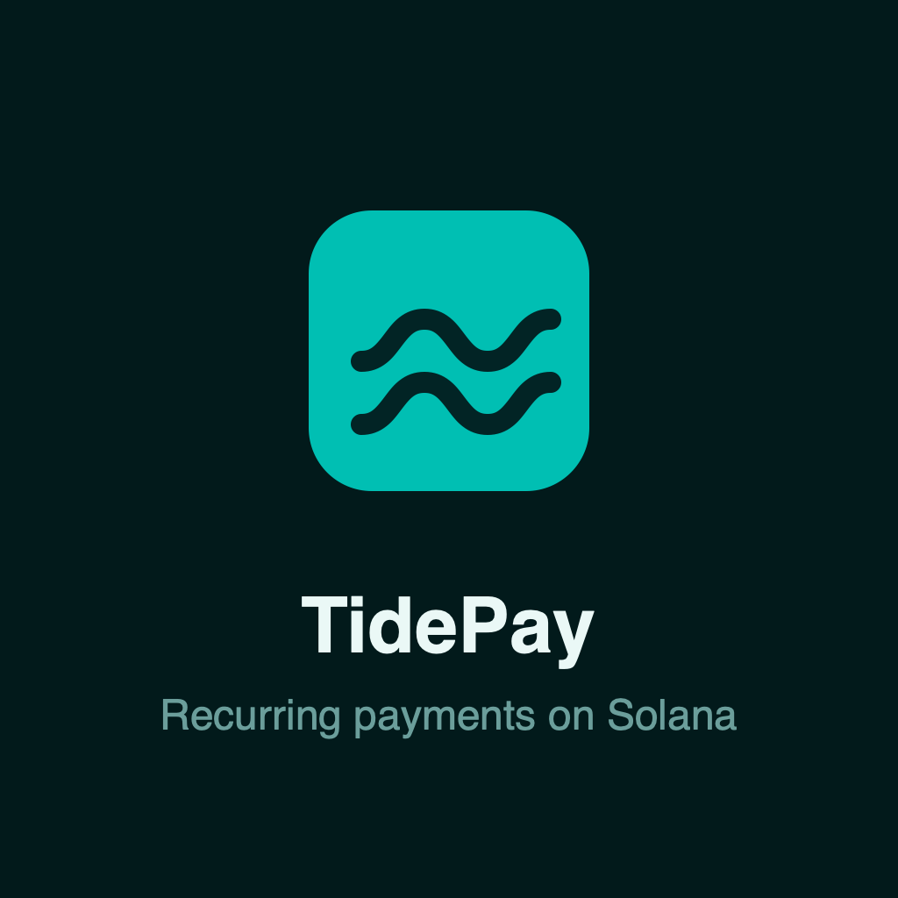
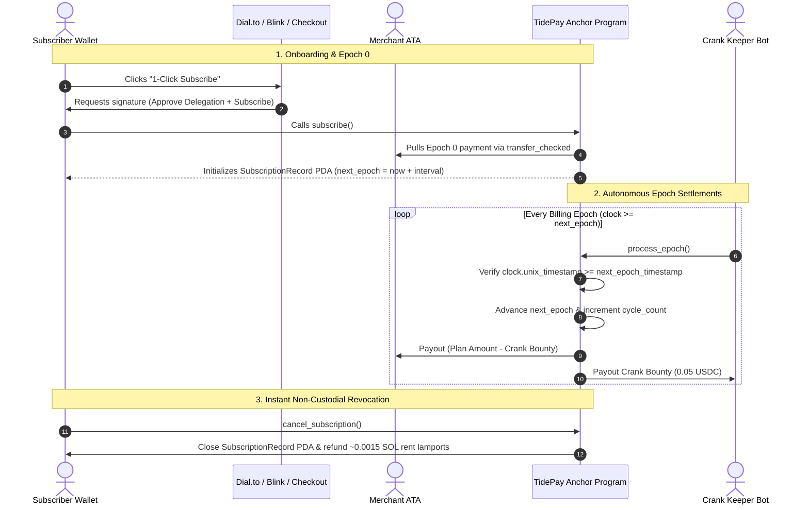
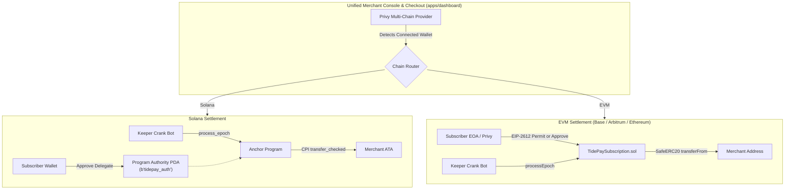

<div align="center">



# TidePay

**The Non-Custodial Recurring Subscription & Billing Engine for Solana**  
*Built natively for the Colosseum Solana Hackathon 2026*

[](https://explorer.solana.com/address/DfAycPzXuSu4EzqfAprZ11S8oQZ6nucuRniFNrNaK5CQ?cluster=devnet)
[](https://www.anchor-lang.com/)
[](https://nextjs.org/)
[](https://www.typescriptlang.org/)
[](https://vitest.dev/)
[](https://opensource.org/licenses/MIT)

[🌐 Live Landing](https://tidepay.vercel.app) • [📊 Merchant Console](https://app-tidepay.vercel.app) • [⚡ Actions API](https://api-tidepay.vercel.app) • [📑 Architecture & PRD](./docs/ARCHITECTURE_AND_PRD.md)

</div>

---

## ⚡ The Problem & The TidePay Paradigm

Traditional Web3 subscription implementations force users to lock upfront capital in custodial escrow vaults or manually sign monthly approval popups. 

* **Custodial Escrows:** Freeze user liquidity, forfeit DeFi staking/yield, and create tempting smart contract hack honeypots.
* **Monthly Signatures:** Asking users for monthly wallet popups causes catastrophic drop-off (up to 80% churn).

### The TidePay Solution: Non-Custodial Delegated Pull
TidePay replaces custodial escrow vaults with deterministic, on-chain time-locked pull delegation:

1. **Zero Vault Lockups & Non-Custodial:** Subscribers authorize an SPL Token delegation (`approve`) to the Program Authority PDA (`b"tidepay_auth"`). Capital remains in the subscriber's personal wallet earning staking/yield until billing is due.
2. **Deterministic Time-Locks:** Settlements enforce `clock.unix_timestamp >= record.next_epoch_timestamp` directly on-chain before executing `transfer_checked`.
3. **Re-Entrancy Immune:** State mutations (`cycle_count`, `next_epoch_timestamp`) occur **before** external CPI token transfers (Checks-Effects-Interactions pattern).
4. **1-Click Solana Blinks:** Merchants can turn any plan into an interactive Twitter/X or Dial.to checkout card via Solana Actions.
5. **Decentralized Keeper Network:** Autonomous bots continuously scan for due epochs and trigger settlement transactions for a 0.05 USDC keeper bounty paid directly from merchant revenue.
6. **Rent Cleanliness:** Cancelling a subscription deletes the `SubscriptionRecord` PDA on-chain and refunds all ~0.0015 SOL rent lamports straight back to the user (`close = subscriber`).

---

## 📊 Paradigm Comparison

| Feature | Traditional Web2 (Stripe) | Custodial Web3 Escrow | TidePay (Solana) |
| :--- | :--- | :--- | :--- |
| **Custody of Funds** | Centralized Merchant/Bank | Smart Contract Vault | **Non-Custodial (User Wallet)** |
| **Transaction Fees** | 2.9% + $0.30 per charge | Variable Gas + Slippage | **Sub-cent Solana Gas + 0.5% fee** |
| **Chargeback Risk** | High (Fraud/Disputes) | None | **Zero (Irreversible on-chain)** |
| **User Drop-off** | Low | High (Upfront Lockup) | **Zero (1-Click Blink Approval)** |
| **Staking/DeFi Yield** | Lost | Lost in Vault | **Retained by User until Settlement** |
| **Account Rent** | N/A | Trapped in Protocol | **100% Refunded on Cancellation** |

---

## 🛰️ Live On-Chain Deployments (Solana Devnet)

| Component | Identifier / Address | Details |
| :--- | :--- | :--- |
| **Program ID** | [`DfAycPzXuSu4EzqfAprZ11S8oQZ6nucuRniFNrNaK5CQ`](https://explorer.solana.com/address/DfAycPzXuSu4EzqfAprZ11S8oQZ6nucuRniFNrNaK5CQ?cluster=devnet) | Anchor 0.30+ program deployed on Solana Devnet |
| **Program Authority PDA** | Derived from `[b"tidepay_auth"]` | Non-custodial pull delegate for CPI `transfer_checked` |
| **Devnet USDC Mint** | [`4zMMC9srt5Ri5X14GAgXhaHii3GnPAEERYPJgZJDncDU`](https://explorer.solana.com/address/4zMMC9srt5Ri5X14GAgXhaHii3GnPAEERYPJgZJDncDU?cluster=devnet) | Official Circle Devnet Mint (6 Decimals) |
| **RPC Cluster** | `https://api.devnet.solana.com` | High-performance Solana Devnet RPC |
| **Actions API** | `https://api-tidepay.vercel.app` | Dial.to & Twitter/X Solana Actions specification |

### EVM Testnet Deployments (Sepolia & Base Sepolia)

| Network | Component | Address | Details |
| :--- | :--- | :--- | :--- |
| **Ethereum Sepolia** | Official Circle USDC | [`0x1c7D4B196Cb0C7B01d743Fbc6116a902379C7238`](https://sepolia.etherscan.io/token/0x1c7D4B196Cb0C7B01d743Fbc6116a902379C7238) | Official Circle Testnet USDC (6 Decimals, EIP-2612 Permit) |
| **Base Sepolia** | Official Circle USDC | [`0x036CbD53842c5426634e7929541eC2318f3dCF7e`](https://sepolia.basescan.org/token/0x036CbD53842c5426634e7929541eC2318f3dCF7e) | Official Circle Testnet USDC (6 Decimals, EIP-2612 Permit) |
| **EVM Engine** | `TidePaySubscription.sol` | Configured via `NEXT_PUBLIC_EVM_CONTRACT_ADDRESS` | Non-Custodial Pull Delegation with Re-Entrancy Guard |

---

## 🏗️ Architecture & Settlement Lifecycle



---

## 🌐 Multi-Chain Architecture: Solana vs EVM

TidePay maintains identical non-custodial billing invariants across both Solana and EVM networks (Ethereum Sepolia, Base Sepolia, Arbitrum), routed through a unified Privy multi-chain frontend.



### Architectural Invariant Parity

| Layer / Invariant | Solana Implementation | EVM Implementation (Ethereum / Base) |
| :--- | :--- | :--- |
| **Pull Authority** | SPL Token `approve` to Program Authority PDA (`b"tidepay_auth"`) | ERC-20 `approve` or EIP-2612 `permit` to `TidePaySubscription.sol` |
| **1-Click Checkout** | Solana Actions & Blinks (Dial.to / Twitter/X) | EIP-2612 typed signature permit (gasless 1-step subscription) |
| **Settlement Trigger** | On-chain Anchor CPI via `transfer_checked` | On-chain Solidity execution via `SafeERC20.transferFrom` |
| **Time-Lock Rule** | `clock.unix_timestamp >= record.next_epoch_timestamp` | `block.timestamp >= subscription.nextEpochTimestamp` |
| **Re-Entrancy Guard** | State updated before CPI calls | `nonReentrant` modifier + Checks-Effects-Interactions pattern |
| **Keeper Crank** | Autonomous Node.js crank (`process_epoch`) for 0.05 USDC bounty | Shared TypeScript crank (`processEpoch`) with keeper bounty payout |
| **Account Rent Cleanup** | PDA closed via `close = subscriber` (returns ~0.0015 SOL) | State flag deactivated (`isActive = false`) |

---

## 🧪 Judge & Evaluator Quickstart (2-Minute Test)

Judges can test the entire lifecycle in under two minutes without waiting 30 days:

1. **Connect on Devnet:** Open [app-tidepay.vercel.app](https://app-tidepay.vercel.app) with your wallet set to **Solana Devnet** (with test SOL and test USDC).
2. **Create Fast-Forward Plan:** Click **Create Plan** and select the **60s Demo** interval slider.
3. **Subscribe via Blink or Hosted Checkout:** Click **Share Blink** to open on [dial.to](https://dial.to) or open the hosted checkout page. Confirm the transaction.
4. **Observe Autonomous Renewal:** After 60 seconds, our off-chain keeper crank settles the epoch, triggering automated renewal on-chain.
5. **Verify Rent Refund:** Cancel the subscription in the console: the `SubscriptionRecord` PDA is instantly closed, and all ~0.0015 SOL rent lamports are returned to your wallet.

---

## 📦 Monorepo Structure

```
tidepay/
├── apps/
│   ├── dashboard/       # Next.js 15 App Router merchant console & checkout (app-tidepay.vercel.app)
│   ├── api/             # Next.js Solana Actions / Blinks & developer REST API (api-tidepay.vercel.app)
│   └── web/             # Marketing landing page, docs portal & brand assets (tidepay.vercel.app)
├── packages/
│   ├── protocol/        # Anchor 0.30+ Rust program & automated keeper crank daemon
│   ├── contracts-evm/   # Solidity TidePaySubscription contract & EVM deployment configs
│   ├── types/           # Shared IDL, TypeScript interfaces, PDA seeds & EVM ABIs
│   └── sdk/             # @tidepay/sdk integration client library (Solana & EVM)
└── docs/
    └── ARCHITECTURE_AND_PRD.md  # Detailed technical specifications & PRD
```

> **Decoupled Architecture Guarantee:** Apps in `apps/*` interact strictly via `@tidepay/sdk` and `@tidepay/types`. They never import directly from `packages/protocol`.

---

## 💻 Developer SDK Quickstart

### 1. Installation
```bash
pnpm add @tidepay/sdk @solana/web3.js @coral-xyz/anchor @solana/spl-token
```

### 2. Feature Gating in Middleware
```typescript
import { Connection, PublicKey } from "@solana/web3.js";
import { TidePayClient } from "@tidepay/sdk";

const connection = new Connection("https://api.devnet.solana.com", "confirmed");
const client = new TidePayClient(connection);

// Verify active subscription status with zero custodial lookups
export async function isSubscribed(planPda: PublicKey, userWallet: PublicKey): Promise<boolean> {
  const [subscriptionPda] = client.findSubscriptionRecordPda(planPda, userWallet);
  const record = await client.getSubscriptionRecord(subscriptionPda);
  
  const now = BigInt(Math.floor(Date.now() / 1000));
  // 120s grace period for crank settlement
  return Boolean(record?.isActive && now <= (record.nextEpochTimestamp + 120n));
}
```

---

## 🚀 Running Locally

```bash
# 1. Install dependencies
pnpm install

# 2. Run all applications concurrently via Turborepo
pnpm dev

# Dashboard: http://localhost:3000
# Actions API: http://localhost:3001
# Web / Docs: http://localhost:3002
```

### Running Test Suites
```bash
# Run Vitest test suites (39+ passing unit & integration tests)
pnpm --filter dashboard test

# Run Rust Protocol unit tests
cargo test --manifest-path packages/protocol/Cargo.toml
```

---

## 🛡️ Hackathon Submission Status

- [x] Anchor Program deployed on Solana Devnet (`DfAycPzXuSu4EzqfAprZ11S8oQZ6nucuRniFNrNaK5CQ`)
- [x] Fast-Forward Demo mode (60-second billing interval for live judging demonstrations)
- [x] Non-custodial pull delegation and instant rent lamports refunds (`close = subscriber`)
- [x] Autonomous keeper crank worker with in-memory concurrency locks
- [x] Solana Actions & Blinks spec compliant (`actions.json`, Dial.to preview, CORS headers)
- [x] Light & Dark theme support across merchant console, docs portal, and hosted checkout
- [x] Zero custodial escrow vaults invariant enforced on-chain
- [x] Comprehensive PRD & Technical Architecture specification (`docs/ARCHITECTURE_AND_PRD.md`)

---

## 📄 License

This repository is licensed under the [MIT License](LICENSE).
