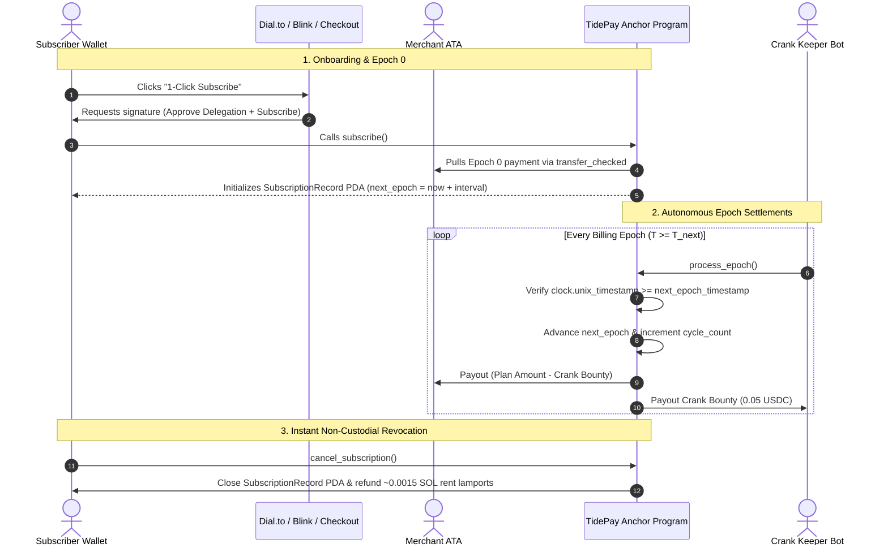

# TidePay 🌊

**Non-Custodial Recurring Subscription & Billing Engine for Solana**  
*Built for the Colosseum Solana Hackathon 2026*

[](https://explorer.solana.com/address/DfAycPzXuSu4EzqfAprZ11S8oQZ6nucuRniFNrNaK5CQ?cluster=devnet)
[](https://www.anchor-lang.com/)
[](https://nextjs.org/)
[](https://www.typescriptlang.org/)

---

## ⚡ The Problem & The TidePay Solution

Traditional Web3 subscription implementations force users to lock upfront capital in custodial escrow vaults or manually sign monthly approval popups. 

**TidePay replaces escrow contracts with a deterministic delegated pull engine:**
1. **Zero Lockups & Non-Custodial:** Subscribers authorize a token delegation (`approve`) to the Program Authority PDA (`b"tidepay_auth"`). Capital remains in the subscriber's personal wallet earning staking/yield until billing is due.
2. **Deterministic Time-Locks:** Settlements enforce `clock.unix_timestamp >= record.next_epoch_timestamp` directly on-chain before executing `transfer_checked`.
3. **Re-Entrancy Immune:** Timestamp and cycle count states mutate **before** external CPI token transfers.
4. **1-Click Solana Blinks:** Merchants can turn any plan into an interactive Twitter/X or Dial.to checkout card via Solana Actions.
5. **Decentralized Keeper Network:** Autonomous bots continuously scan for due epochs and trigger settlement transactions for a 0.05 USDC keeper bounty paid directly from merchant revenue.
6. **Rent Cleanliness:** Cancelling a subscription deletes the `SubscriptionRecord` PDA on-chain and refunds all ~0.0015 SOL rent lamports straight back to the user (`close = subscriber`).

---

## 🛰️ Live On-Chain Deployments (Solana Devnet)

| Component | Identifier / Address | Explorer Link |
| :--- | :--- | :--- |
| **Program ID** | `DfAycPzXuSu4EzqfAprZ11S8oQZ6nucuRniFNrNaK5CQ` | [View on Solana Explorer](https://explorer.solana.com/address/DfAycPzXuSu4EzqfAprZ11S8oQZ6nucuRniFNrNaK5CQ?cluster=devnet) |
| **Program Authority PDA** | Derived from `[b"tidepay_auth"]` | Non-custodial pull delegate for `transfer_checked` |
| **Devnet USDC Mint** | `4zMMC9srt5Ri5X14GAgXhaHii3GnPAEERYPJgZJDncDU` | Circle Official Devnet Mint (6 Decimals) |
| **RPC Cluster** | `https://api.devnet.solana.com` | High-performance Solana Devnet RPC |

---

## 🏗️ Architecture Flow



---

## 📦 Monorepo Structure

```
├── apps/
│   ├── dashboard/       # Next.js 15 App Router merchant console & checkout (app.tidepay.xyz)
│   └── api/             # Next.js Solana Actions / Blinks & developer REST API (api.tidepay.xyz)
├── packages/
│   ├── protocol/        # Anchor 0.30+ Rust program & Crank keeper daemon
│   ├── types/           # Shared IDL, TypeScript interfaces, and PDA seed constants
│   └── sdk/             # @tidepay/sdk integration client library
```

> **Decoupled Architecture Guarantee:** Apps in `apps/*` interact strictly via `@tidepay/sdk` and `@tidepay/types`. They never import directly from `packages/protocol`.

---

## 💻 30-Second SDK Quickstart

### 1. Installation
```bash
pnpm add @tidepay/sdk @solana/web3.js @coral-xyz/anchor @solana/spl-token
```

### 2. Feature Gating in API or Middleware
```typescript
import { Connection, PublicKey } from "@solana/web3.js";
import { TidePayClient } from "@tidepay/sdk";

const connection = new Connection("https://api.devnet.solana.com", "confirmed");
const client = new TidePayClient(connection);

// Verify active subscription status with zero custodial lookups
export async function isSubscribed(planPda: PublicKey, userWallet: PublicKey): Promise<boolean> {
  const [subscriptionPda] = client.findSubscriptionRecordPda(planPda, userWallet);
  const record = await client.getSubscriptionRecord(subscriptionPda);
  
  const now = BigInt(Math.floor(Date.now() / 1000));
  // 120s grace period for crank settlement
  return Boolean(record?.isActive && now <= (record.nextEpochTimestamp + 120n));
}
```

---

## 🚀 Running Locally

```bash
# 1. Install dependencies
pnpm install

# 2. Run all applications concurrently via Turborepo
pnpm dev

# Dashboard runs on http://localhost:3000
# Actions API runs on http://localhost:3001
```

### Running Tests
```bash
# Run Vitest test suites (39+ passing tests)
pnpm --filter dashboard test

# Run Rust Protocol unit tests
cargo test --manifest-path packages/protocol/Cargo.toml
```

---

## 🛡️ Hackathon Submission Status

- [x] Anchor Program deployed on Solana Devnet (`DfAycPzXuSu4EzqfAprZ11S8oQZ6nucuRniFNrNaK5CQ`)
- [x] Fast-Forward Demo mode (60-second billing interval for live judging demonstrations)
- [x] Non-custodial pull delegation and instant rent lamports refunds (`close = subscriber`)
- [x] Autonomous keeper crank worker with in-memory concurrency locks
- [x] Solana Actions & Blinks spec compliant (`actions.json`, Dial.to preview, CORS headers)
- [x] Light & Dark theme support across merchant console, docs portal, and hosted checkout
- [x] Zero custodial escrow vaults invariant enforced on-chain
