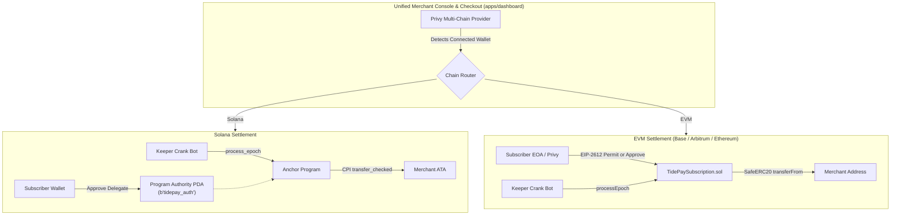

# TidePay — Product Requirements Document (PRD) & Technical Architecture Specification

**Project Name:** TidePay  
**Version:** 1.0.0 (Colosseum Hackathon Edition)  
**Status:** Live on Solana Devnet  
**Program ID:** `DfAycPzXuSu4EzqfAprZ11S8oQZ6nucuRniFNrNaK5CQ`  
**Repository:** [github.com/TeddyHuZz/tidepay](https://github.com/TeddyHuZz/tidepay)  

---

## 1. Executive Summary

TidePay is a non-custodial, recurring subscription and billing engine built natively for Solana. Traditional Web3 subscription models force users into one of two compromises: locking upfront capital into custodial escrow vaults (sacrificing liquidity, losing staking yield, and creating smart contract hack honeypots) or requiring repetitive monthly manual wallet signatures (which causes catastrophic subscriber churn).

TidePay resolves this dilemma through **deterministic, non-custodial delegated pull billing**:
1. **Zero Escrow Lockups:** Subscribers authorize an SPL Token delegation (`approve`) to a Program Authority PDA (`b"tidepay_auth"`). Capital remains in the subscriber's personal wallet until the exact second an epoch is due.
2. **Deterministic Time-Locks:** Settlements enforce `clock.unix_timestamp >= record.next_epoch_timestamp` directly on-chain before executing `transfer_checked`.
3. **Re-Entrancy Immune:** Timestamp and cycle count states mutate **before** external CPI token transfers (Checks-Effects-Interactions pattern).
4. **1-Click Solana Blinks:** Merchants can turn any plan into an interactive Twitter/X or Dial.to checkout card via Solana Actions.
5. **Decentralized Keeper Network:** Autonomous bots continuously scan for due epochs and trigger settlement transactions for a 0.05 USDC keeper bounty paid directly from merchant revenue.
6. **Rent Cleanliness:** Cancelling a subscription deletes the `SubscriptionRecord` PDA on-chain and refunds all ~0.0015 SOL rent lamports straight back to the user (`close = subscriber`).

---

## 2. Product Requirements Document (PRD)

### 2.1 Product Vision & Objectives
Provide the fundamental billing primitive for the decentralized subscription economy, enabling Web3 SaaS, autonomous AI agents, media creators, and decentralized services to collect predictable recurring revenue without custodial risks.

### 2.2 Target User Personas
* **Web3 SaaS & Developer Tooling:** RPC node providers, data indexers, and API services requiring automated monthly/annual recurring revenue (MRR/ARR).
* **Autonomous AI Agents:** Autonomous on-chain agents requiring machine-to-machine recurring micropayments without interactive human wallet confirmations.
* **Content Creators & Alpha Communities:** Newsletters, trading alpha groups, and Discord communities monetizing directly across social media channels (X/Twitter, Dial.to) via 1-click Blinks.
* **End Users / Subscribers:** Consumers demanding seamless recurring services without exposing themselves to custodial vault exploits or manual monthly signing fatigue.

### 2.3 Core Functional Requirements

| Requirement ID | Module | Description | Acceptance Criteria |
| :--- | :--- | :--- | :--- |
| **FR-01** | Plan Management | Merchants can create customizable recurring billing plans specifying token mint, amount, interval, crank bounty, and plan ID. | Plan PDA initialized with unique seed `[b"plan", merchant, plan_id]`. |
| **FR-02** | Fast-Forward Mode | Plan creation supports a 60-second test interval for live demo and judge evaluation. | Intervals down to 60s settle properly without off-chain simulation delays. |
| **FR-03** | 1-Click Subscription | Subscribers authorize pull delegation and execute Epoch 0 billing in an atomic transaction. | SPL token delegation verified; `SubscriptionRecord` initialized; Epoch 0 pulled via `transfer_checked`. |
| **FR-04** | Solana Actions / Blinks | Generates Dial.to and Twitter-compliant action URLs and metadata (`actions.json`). | Returns GET metadata and POST versioned transaction (v0) compliant with Dialect specification. |
| **FR-05** | Autonomous Settlement | Decentralized keeper crank settles due subscriptions and receives incentive bounty. | Enforces `clock.unix_timestamp >= next_epoch`; increments cycle count; splits payment between merchant and keeper. |
| **FR-06** | Instant Revocation | Subscribers can cancel subscriptions at any time with immediate rent recovery. | Account PDA closed via `close = subscriber`; rent lamports (~0.0015 SOL) returned; delegation revocable. |
| **FR-07** | Merchant Console | Comprehensive web dashboard displaying subscriber lists, active MRR, settlement history, and Blink share links. | Next.js 15 App Router connecting to Solana Devnet and Neon Postgres database. |

### 2.4 Non-Functional Requirements
* **Non-Custodial Invariance:** At no point shall any smart contract vault hold subscriber funds. All transfers must originate from subscriber ATAs via program-delegated authority.
* **Execution Latency:** Solana Actions API response latency must remain under 300ms to prevent Blink client timeouts.
* **Gas & Compute Efficiency:** On-chain instruction compute units (CU) must not exceed 65,000 CU per settlement transaction.
* **Decimal Integrity:** Strict usage of `transfer_checked` rather than `transfer` to prevent mint decimal mismatch attacks.

---

## 3. System & Technical Architecture

### 3.1 Architecture Overview

```mermaid
graph TD
    subgraph Client Layer
        A1[Merchant Console - apps/dashboard]
        A2[Hosted Checkout - apps/dashboard]
        A3[Social Feed / Dial.to Blinks - Twitter/X]
    end

    subgraph API & Gateway Layer
        B1[Actions API - apps/api]
        B2[REST / Webhook Gateway]
    end

    subgraph SDK & Integration
        C1[@tidepay/sdk]
        C2[@tidepay/types]
    end

    subgraph Off-Chain Workers
        D1[Keeper Crank Daemon - Node.js/TS]
        D2[Lock Pool & Memcmp Scanner]
    end

    subgraph On-Chain Program [Anchor 0.30+ on Solana Devnet]
        E1[Program Authority PDA - b'tidepay_auth']
        E2[MerchantPlan PDA - b'plan']
        E3[SubscriptionRecord PDA - b'subscription']
    end

    A1 --> C1
    A2 --> C1
    A3 --> B1
    B1 --> C1
    C1 --> E1
    C1 --> E2
    C1 --> E3
    D1 --> D2
    D2 --> E3
```

### 3.2 Monorepo Architecture

```
tidepay/
├── apps/
│   ├── dashboard/       # Merchant management console & hosted checkout (Next.js 15)
│   ├── api/             # Solana Actions / Blinks spec endpoints & developer APIs (Next.js 15)
│   └── web/             # Marketing landing page, documentation, and showcase
├── packages/
│   ├── protocol/        # Anchor 0.30+ Rust program & automated keeper crank daemon
│   ├── contracts-evm/   # Solidity smart contracts (TidePaySubscription.sol)
│   ├── types/           # Shared IDL, TypeScript interfaces, PDA seeds & EVM ABIs
│   └── sdk/             # @tidepay/sdk client library for Web3 developers (Solana + EVM)
```

*Code in `apps/*` strictly interacts via `@tidepay/sdk` and `@tidepay/types`. Direct imports from protocol packages are forbidden.*

### 3.3 Multi-Chain Architecture: Solana vs EVM

TidePay maintains identical non-custodial billing invariants across both Solana and EVM networks (Ethereum Sepolia, Base Sepolia, Arbitrum), routed through a unified Privy multi-chain frontend.



#### Architectural Invariant Parity

| Layer / Invariant | Solana Implementation | EVM Implementation (Ethereum / Base) |
| :--- | :--- | :--- |
| **Pull Authority** | SPL Token `approve` to Program Authority PDA (`b"tidepay_auth"`) | ERC-20 `approve` or EIP-2612 `permit` to `TidePaySubscription.sol` |
| **1-Click Checkout** | Solana Actions & Blinks (Dial.to / Twitter/X) | EIP-2612 typed signature permit (gasless 1-step subscription) |
| **Settlement Trigger** | On-chain Anchor CPI via `transfer_checked` | On-chain Solidity execution via `SafeERC20.transferFrom` |
| **Time-Lock Rule** | `clock.unix_timestamp >= record.next_epoch_timestamp` | `block.timestamp >= subscription.nextEpochTimestamp` |
| **Re-Entrancy Guard** | State updated before CPI calls | `nonReentrant` modifier + Checks-Effects-Interactions pattern |
| **Keeper Crank** | Autonomous Node.js crank (`process_epoch`) for 0.05 USDC bounty | Shared TypeScript crank (`processEpoch`) with keeper bounty payout |
| **Account Rent Cleanup** | PDA closed via `close = subscriber` (returns ~0.0015 SOL) | State flag deactivated (`isActive = false`) |

---


## 4. On-Chain Protocol Specification (Rust / Anchor)

### 4.1 Program Accounts & State Structs

#### `MerchantPlan`
Stores merchant billing configurations and pricing parameters.
```rust
#[account]
#[derive(InitSpace)]
pub struct MerchantPlan {
    pub merchant: Pubkey,               // Merchant owner wallet (32 bytes)
    pub token_mint: Pubkey,             // Billing currency mint (USDC/SOL) (32 bytes)
    pub merchant_token_account: Pubkey, // Merchant destination ATA (32 bytes)
    pub amount: u64,                    // Amount charged per epoch in base units (8 bytes)
    pub interval_seconds: i64,          // Interval between billing epochs (8 bytes)
    #[max_len(32)]
    pub plan_id: String,                // Merchant unique plan identifier (4 + 32 bytes)
    pub protocol_fee_bps: u16,          // Protocol fee in basis points (10,000 = 100%) (2 bytes)
    pub crank_bounty_amount: u64,       // Reward paid to keeper bot per settlement (8 bytes)
    pub is_active: bool,                // Plan status flag (1 byte)
    pub bump: u8,                       // PDA bump seed (1 byte)
}
```

#### `SubscriptionRecord`
Maintains individual subscriber state and chronological billing counters.
```rust
#[account]
#[derive(InitSpace)]
pub struct SubscriptionRecord {
    pub plan: Pubkey,                      // Associated MerchantPlan PDA (32 bytes)
    pub subscriber: Pubkey,                // Subscriber wallet address (32 bytes)
    pub subscriber_token_account: Pubkey,  // Subscriber source ATA (32 bytes)
    pub start_timestamp: i64,              // Initial subscription timestamp (8 bytes)
    pub last_epoch_timestamp: i64,         // Most recent settled epoch timestamp (8 bytes)
    pub next_epoch_timestamp: i64,         // Earliest allowable next settlement timestamp (8 bytes)
    pub cycle_count: u64,                  // Total successful billing iterations (8 bytes)
    pub is_active: bool,                   // Active subscription status (1 byte)
    pub bump: u8,                          // PDA bump seed (1 byte)
}
```

### 4.2 Program Derived Addresses (PDAs)

| PDA Name | Seeds | Purpose |
| :--- | :--- | :--- |
| **`ProgramAuthority`** | `[b"tidepay_auth"]` | Serves as the delegated pull authority signer for CPI `transfer_checked` calls. |
| **`MerchantPlan`** | `[b"plan", merchant.key().as_ref(), plan_id.as_bytes()]` | Uniquely identifies a merchant's billing plan. |
| **`SubscriptionRecord`** | `[b"subscription", plan.key().as_ref(), subscriber.key().as_ref()]` | Tracks billing progress, cycle counters, and timestamps. |

### 4.3 Program Instructions

1. **`initialize_plan`**: Initializes a `MerchantPlan` PDA. Configures billing interval, price, token mint, and crank bounty.
2. **`subscribe`**: Validates the subscriber has approved delegation to `ProgramAuthority`. Initializes `SubscriptionRecord`, advances `next_epoch_timestamp = now + interval`, and pulls Epoch 0 payment via CPI `transfer_checked`.
3. **`process_epoch`**: Crank keeper call. Verifies `clock.unix_timestamp >= next_epoch_timestamp`. Mutates `next_epoch_timestamp` and `cycle_count`, splits funds into merchant payout and crank bounty, and pulls tokens via CPI `transfer_checked`.
4. **`cancel_subscription`**: Allows subscriber or merchant to terminate subscription. Closes `SubscriptionRecord` account and returns all rent lamports to the subscriber (`close = subscriber`).
5. **`toggle_plan_status`**: Enables merchant to pause or reactivate plans.

---

## 5. Security & Defensive Engineering

### 5.1 Re-Entrancy Immunity
TidePay strictly enforces the **Checks-Effects-Interactions** pattern across all billing instructions. State mutations (`next_epoch_timestamp`, `cycle_count`, `last_epoch_timestamp`) are persisted on the `SubscriptionRecord` account **prior** to invoking external CPI token transfer calls.

```rust
// 1. Checks & Effects: Mutate state before CPI
subscription.last_epoch_timestamp = now;
subscription.next_epoch_timestamp = now.checked_add(plan.interval_seconds).ok_or(TidePayError::MathOverflow)?;
subscription.cycle_count = subscription.cycle_count.checked_add(1).ok_or(TidePayError::MathOverflow)?;

// 2. Interactions: CPI transfer signed with program authority PDA
token_interface::transfer_checked(cpi_ctx, merchant_payout, decimals)?;
```

### 5.2 Decimal Validation
To prevent decimal spoofing attacks between standard SPL Token and Token-2022 mints, all transfers strictly execute `transfer_checked` passing the verified on-chain mint decimals.

### 5.3 Zero Custodial Risk Invariant
Funds are never transferred to a program-controlled token vault. The `ProgramAuthority` PDA acts solely as an authorized pull delegate on the subscriber's own ATA. If a user revokes delegation or spends their balance, the crank simply halts execution with a handled error (`InsufficientAllowance`), protecting the subscriber from protocol-level liquidity drains.

---

## 6. Keeper Crank & Relayer Specification

### 6.1 Settlement Daemon Architecture
The keeper crank operates as an autonomous background worker in Node.js/TypeScript:
1. **Memcmp Querying:** Periodically scans the Solana ledger using `connection.getProgramAccounts()` with `dataSlice` and `memcmp` filters targeting `is_active == true`.
2. **In-Flight Lock Pool:** Implements an in-memory `Set<string>` lock pool tracking active subscription PDAs to eliminate duplicate concurrent transactions for the same due epoch.
3. **Bounty Distribution:** For every valid settlement transaction submitted, the contract automatically directs `crank_bounty_amount` (0.05 USDC) into the keeper keypair's ATA.
4. **Resilience:** Implements exponential backoff retry algorithms to handle Devnet RPC rate limits (HTTP 429) and blockhash expirations.

---

## 7. Solana Actions & Blinks Integration

TidePay implements the official Solana Actions specification to turn recurring subscriptions into shareable social primitives:

* **Endpoint:** `GET/POST /api/actions/subscribe/[planAddress]`
* **CORS Compliance:** Configured with universal headers (`Access-Control-Allow-Origin: *`, `X-Action-Version: 2.1.3`, `X-Blockchain-Ids: solana:devnet`).
* **Transaction Construction:** Constructs `v0` Versioned Transactions combining:
  1. `ComputeBudgetProgram.setComputeUnitLimit({ units: 150_000 })`
  2. `createApproveCheckedInstruction(...)` (delegates allowance to `ProgramAuthority` PDA)
  3. `TidePayClient.buildSubscribeInstruction(...)` (initiates on-chain subscription)

Subscribers can sign directly from Dial.to, Twitter/X cards, or Solana wallet extension popups in a single signature flow.

---

## 8. Verification & Test Suite

The TidePay repository maintains comprehensive test coverage across both protocol and application layers:
* **Protocol Unit Tests:** Rust Anchor integration tests validating plan initialization, subscriber onboarding, epoch progression, bounty calculation, and unauthorized access rejections.
* **SDK Integration Tests:** Vitest test suite (39+ passing tests) validating PDA derivations, instruction byte encoding, big-integer hygiene, and client RPC error parsing.
* **End-to-End Devnet Verification:** Deployed and actively tested on Solana Devnet under Program ID `DfAycPzXuSu4EzqfAprZ11S8oQZ6nucuRniFNrNaK5CQ`.

---

## 9. Product Roadmap

* **Phase 1 (Current - Colosseum Hackathon):** Deployed Anchor core protocol, keeper crank, Next.js 15 merchant dashboard, `@tidepay/sdk`, and Solana Blinks checkout.
* **Phase 2 (Post-Hackathon):** Mainnet-Beta deployment, multi-token collateral pools (EURC, SOL, JitoSOL), and Dialect Actions registry listing.
* **Phase 3 (Ecosystem Expansion):** Token-2022 Transfer Hook extensions, machine-to-machine AI agent billing SDK plugins, and enterprise Webhook event streams.
